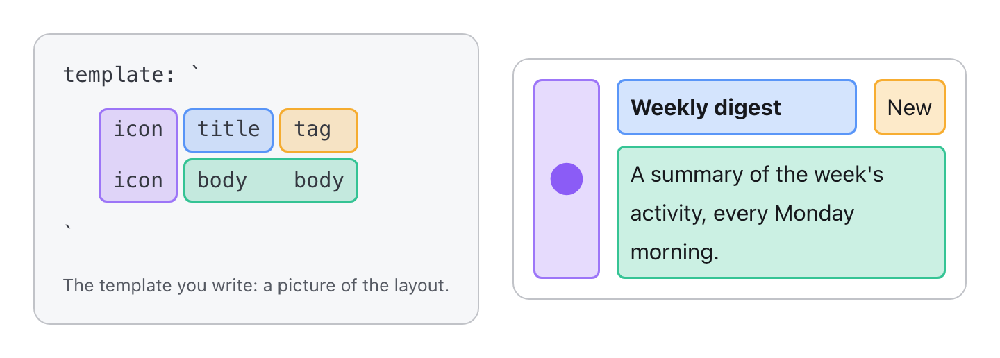

# typed-grid-areas

[](https://michaelbuss.github.io/typed-grid-areas/)
[](https://michaelbuss.github.io/typed-grid-areas/try-it/)
[](https://www.npmjs.com/package/typed-grid-areas)
[](https://bundlejs.com/?q=typed-grid-areas)
[](https://github.com/MichaelBuss/typed-grid-areas/blob/main/LICENSE)

**Describe a grid once. Every combination of slots lays itself out.**


## Grid template areas, in one picture

CSS can draw a layout as text. With
[`grid-template-areas`](https://developer.mozilla.org/en-US/docs/Web/CSS/grid-template-areas)
you name a grid's regions and write the names down the way the regions sit
on screen; each child then takes its region by name. The template is a
picture of the component:



## Simple on paper, hard in practice

- **The names are unchecked strings.** A typo, in the template or on a
  child, quietly puts the child somewhere else. Nothing reports it.
- **One picture fits one set of children.** Leave out the tag and its cells
  stay behind as an empty column. Every combination of optional slots needs
  its own picture behind a `:has()` rule, and every breakpoint multiplies
  them. For a card with an optional icon and tag:

```css
.card {
  display: grid;
  grid-template-areas: "icon information cardTag";
  grid-template-columns: min-content minmax(0, 1fr) auto;
}
.card:not(:has(> .icon)) {
  grid-template-areas: "information cardTag";
  grid-template-columns: minmax(0, 1fr) auto;
}
.card:not(:has(> .cardTag)) {
  grid-template-areas: "icon information";
  grid-template-columns: min-content minmax(0, 1fr);
}
.card:not(:has(> .icon, > .cardTag)) {
  grid-template-areas: "information";
  grid-template-columns: minmax(0, 1fr);
}
/* …and a grid-area rule for each slot */
```

## With typed-grid-areas

Draw the picture once, with every slot present. The library derives the
other three, checks every area name at compile time, and writes the CSS:

```tsx
import { defineLayout } from "typed-grid-areas";
import { createGridComponent } from "@typed-grid-areas/react";

const Card = createGridComponent(
  defineLayout({
    areas: ["icon?", "information", "cardTag?"],
    layouts: [
      {
        template: "icon information cardTag",
        columns: "min-content minmax(0, 1fr) auto",
      },
    ],
  }),
);

function Example({ tag }: { tag?: string }) {
  return (
    <Card className="gap-2">
      <Card.icon>★</Card.icon>
      <Card.information>Weekly digest</Card.information>
      {tag && <Card.cardTag>{tag}</Card.cardTag>}
    </Card>
  );
}
```

Without a tag, the card lays out as `icon information`, with the tag's
column gone. Nothing in your code handles that case. A misspelled area, a
ragged row or a track list that doesn't match is a compile error.

## Why one grid, not nested flexboxes

- **One flat grid.** Every slot is a direct child, placed by name: no
  wrapper divs that only exist to group things for one layout. A new
  arrangement is a new picture, not new markup.
- **It follows what's actually rendered.** `:has()` sees which slots are in
  the page. No `hasIcon` or `compact` props to keep your state and your
  classes in step.
- **Hard to break by accident.** Every area name is type-checked, every
  combination of slots has a layout, even the one nobody tried, and the
  generated CSS has zero specificity, so your own classes always win.
- **Breakpoints follow the grid's own width**, not the viewport's, so a grid
  behaves the same wherever it's placed.
- **Easy to read, for people and agents.** The template is the layout. Type
  errors name the problem where you wrote it, and an agent skill ships with
  the package.
- **Pure CSS at runtime, in any framework.** No JavaScript lays anything
  out. Adapters for React, Vue, Svelte, Solid, Preact, Angular, Lit and
  Octane, and a framework-free core.

## Frameworks

| Framework             | Install                                            | Reference                                                                                                                                                 |
| --------------------- | -------------------------------------------------- | --------------------------------------------------------------------------------------------------------------------------------------------------------- |
| React                 | `npm i typed-grid-areas @typed-grid-areas/react`   | [Rendering with React](https://github.com/MichaelBuss/typed-grid-areas/blob/main/REFERENCE.md#rendering-with-react-grid-components)                       |
| Vue                   | `npm i typed-grid-areas @typed-grid-areas/vue`     | [Rendering with Vue](https://github.com/MichaelBuss/typed-grid-areas/blob/main/REFERENCE.md#rendering-with-vue-typed-grid-areasvue)                       |
| Svelte                | `npm i typed-grid-areas @typed-grid-areas/svelte`  | [Rendering with Svelte](https://github.com/MichaelBuss/typed-grid-areas/blob/main/REFERENCE.md#rendering-with-svelte-typed-grid-areassvelte)              |
| Solid                 | `npm i typed-grid-areas @typed-grid-areas/solid`   | [Rendering with Solid](https://github.com/MichaelBuss/typed-grid-areas/blob/main/REFERENCE.md#rendering-with-solid-typed-grid-areassolid)                 |
| Preact                | `npm i typed-grid-areas @typed-grid-areas/preact`  | [Rendering with Preact](https://github.com/MichaelBuss/typed-grid-areas/blob/main/REFERENCE.md#rendering-with-preact-typed-grid-areaspreact)              |
| Angular               | `npm i typed-grid-areas @typed-grid-areas/angular` | [Rendering with Angular](https://github.com/MichaelBuss/typed-grid-areas/blob/main/REFERENCE.md#rendering-with-angular-grid-directives)                   |
| Lit                   | `npm i typed-grid-areas @typed-grid-areas/lit`     | [Rendering with Lit](https://github.com/MichaelBuss/typed-grid-areas/blob/main/REFERENCE.md#rendering-with-lit-grid-template-functions)                   |
| Octane (experimental) | `npm i typed-grid-areas @typed-grid-areas/octane`  | [Rendering with Octane](https://github.com/MichaelBuss/typed-grid-areas/blob/main/REFERENCE.md#rendering-with-octane-typed-grid-areasoctane-experimental) |
| No framework          | `npm i typed-grid-areas`                           | [Without React](https://github.com/MichaelBuss/typed-grid-areas/blob/main/REFERENCE.md#without-react-typed-grid-areasadapter)                             |

## Install

```sh
npm i typed-grid-areas @typed-grid-areas/react
```

Swap `react` for your framework's package from the table above.

## Agent skill

The core ships a skill that walks a coding agent through writing, converting
and debugging layouts, versioned with each release. Enable it with
[TanStack Intent](https://tanstack.com/intent):

```sh
npx @tanstack/intent@latest install
```

## Learn more

- [Docs](https://michaelbuss.github.io/typed-grid-areas/): how it works,
  the concepts, and live examples.
- [Try it in your browser](https://michaelbuss.github.io/typed-grid-areas/try-it/):
  a playground, and an example app per framework.
- [The full API reference](https://github.com/MichaelBuss/typed-grid-areas/blob/main/REFERENCE.md):
  every option and every adapter. It also ships in every package, matching
  the version you installed: `node_modules/typed-grid-areas/REFERENCE.md`.
